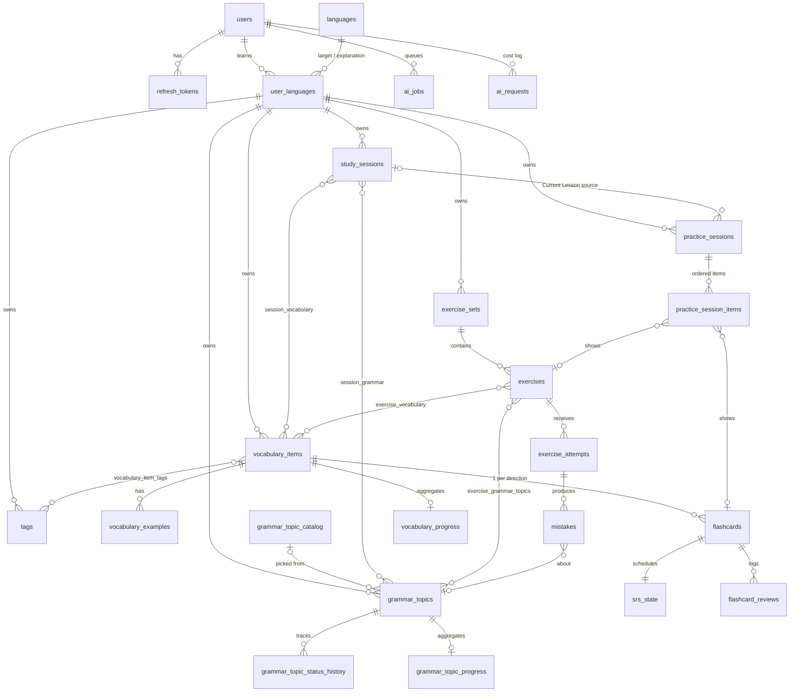

# LinguaFlow Database Schema

Status: **approved** (DB-01, 2026-11-09). The open questions in section 6 were resolved with the recommended options. Target: PostgreSQL 16, migrations with Flyway, JPA with `ddl-auto=validate`.

This document is the contract the migrations (DB-02 to DB-04 and later module tasks) implement. When the schema changes, update this file in the same PR as the migration.

## 1. Conventions

| Topic | Decision | Why |
|---|---|---|
| Primary keys | `uuid`, generated in the app as **UUIDv7** (Hibernate `@UuidGenerator(style = VERSION_7)`) | IDs appear in URLs, and random-looking IDs don't reveal how many rows exist. UUIDv7 is time-ordered, so B-tree inserts stay local. App-side generation also lets Hibernate batch inserts, which matters for bulk vocabulary (VOC-04). Identity columns can't batch. |
| Languages | `languages.code` (ISO 639-1, e.g. `de`) is the natural primary key | The code is short and stable, and it makes rows and logs readable. |
| Names | `snake_case`, plural table names, `<table>_id` foreign keys | |
| Enums | `text` plus a `CHECK (col IN (...))` constraint, mapped with `@Enumerated(STRING)` | Adding a value is one migration line. Postgres `ENUM` types are awkward to change. |
| Time | `timestamptz` everywhere. Calendar days (e.g. `studied_on`) use `date` | The "today" a user sees depends on their timezone (SRS-01), so instants are stored in UTC. |
| Auditing | Mutable tables have `created_at` and `updated_at timestamptz not null`, filled by `AuditableEntity`. Append-only tables (logs, reviews, attempts) have only `created_at` or an event time | |
| Optimistic locking | `version bigint not null default 0` (JPA `@Version`) on rows users edit concurrently: `vocabulary_items`, `grammar_topics`, `study_sessions`, `srs_state`, `practice_sessions` | Stops lost updates, for example two tabs, or an AI enrichment finishing while the user edits. |
| Flexible data | `jsonb` only for data that varies by type and is never filtered relationally: verb forms, exercise prompt and solution, AI feedback, settings snapshots | Anything we filter, join or aggregate on gets its own column. |
| Ownership | Every user-owned top-level table has `user_id`. Learning tables also have `language_code` and a **composite foreign key** `(user_id, language_code) → user_languages`. Child tables that are queried directly (e.g. the due-cards index) copy `user_id` onto themselves | This enforces "all learning data is scoped by (user, target language)" in the database. It also makes AUTH-05's ownership filter (`WHERE user_id = ?`) cheap on every table that's queried. |
| Owner consistency (added in V3) | Wherever a child table copies `user_id`, it references its parent through a composite FK `(parent_id, user_id) → parent(id, user_id)`, backed by a `UNIQUE (id, user_id)` on the parent. This covers flashcards, srs_state, reviews, exercises, attempts, mistakes and the progress tables. `mistakes` uses single-column FKs for its SET NULL links, so the cleared link doesn't wipe `user_id` | The database guarantees the copied `user_id` always matches the real owner. One user's card can't point at another user's word |
| Deletes | Hard deletes. Deleting a user cascades to all their data (SEC-02) | There's no soft delete in the MVP. Status fields (`suspended`, `reported`) cover "hide but keep". |

## 2. Entity-relationship overview

Only keys and relationships are shown here. Section 3 lists the columns.

There are four groups of tables:
- **Identity:** `users`, `refresh_tokens`, `languages`, `user_languages`.
- **Learning material:** vocabulary, grammar, tags, study sessions.
- **Practice:** flashcards, SRS, exercises, attempts, practice sessions.
- **Derived and infrastructure:** progress aggregates and the AI tables.

## 3. Tables

Notation: **PK** primary key, **FK** foreign key (with the delete rule), **UQ** unique, **IX** index, **CK** check constraint. `created_at` and `updated_at` are omitted from the column lists when the conventions above already imply them.

### 3.1 Identity and settings

#### `users` (AUTH-01, USR-01)
| Column | Type | Notes |
|---|---|---|
| id | uuid | PK |
| email | text not null | Stored as entered. **UQ** on `lower(email)` (case-insensitive, AUTH-01) |
| password_hash | text not null | BCrypt or Argon2 |
| display_name | text not null | CK length 1–100 |
| role | text not null default `'USER'` | CK `USER`, `ADMIN` |
| enabled | boolean not null default true | |
| email_verified_at | timestamptz | null until verified (AUTH-07, optional) |
| interface_language_code | text not null default `'en'` | FK → languages (RESTRICT) |
| timezone | text not null default `'UTC'` | IANA name, validated in the app. Defines "today" for SRS and streaks |
| last_login_at | timestamptz | |

#### `refresh_tokens` (AUTH-03)
| Column | Type | Notes |
|---|---|---|
| id | uuid | PK |
| user_id | uuid not null | FK → users **CASCADE** |
| token_hash | text not null | **UQ**. SHA-256 of the opaque token; the raw token is never stored |
| family_id | uuid not null | All rotations of one login share it. Reuse of a rotated token revokes the whole family. **IX** |
| expires_at | timestamptz not null | |
| revoked_at | timestamptz | |
| replaced_by_id | uuid | FK → refresh_tokens (SET NULL) |
| created_at | timestamptz not null | |
| user_agent | text | For a later "active sessions" view |

**IX** `(user_id)`. A scheduled job deletes rows where `expires_at < now() - 30 days`.

#### `user_action_tokens` (AUTH-07, migration V4)
| Column | Type | Notes |
|---|---|---|
| id | uuid | PK |
| user_id | uuid not null | FK → users **CASCADE**. **IX** `(user_id, purpose)` |
| purpose | text not null | CK `EMAIL_VERIFICATION, PASSWORD_RESET` |
| token_hash | text not null | **UQ**. SHA-256 of the token from the email link; the raw token is never stored |
| expires_at | timestamptz not null | CK `> created_at`. Defaults: 48 hours for verification, 1 hour for reset |
| used_at | timestamptz | Set when the link is used. Each token works once |
| created_at | timestamptz not null | |

Issuing a new token for a purpose deletes the user's unused tokens for that purpose, so only the newest link works.

#### `languages` (DB-02 seed: `de`, `en`)
| Column | Type | Notes |
|---|---|---|
| code | text | PK, ISO 639-1. CK `^[a-z]{2,3}$` |
| name | text not null | English name ("German") |
| native_name | text not null | "Deutsch" |
| supported_as_target | boolean not null | Only `de` in the MVP |
| supported_as_explanation | boolean not null | |

#### `user_languages` (USR-02, USR-03): the learner profile per target language
| Column | Type | Notes |
|---|---|---|
| user_id | uuid not null | PK part 1. FK → users **CASCADE** |
| language_code | text not null | PK part 2, the target language. FK → languages (RESTRICT) |
| explanation_language_code | text not null | FK → languages (RESTRICT). CK `<> language_code` |
| self_assessed_level | text | CK CEFR (`A1`…`C2`) |
| active | boolean not null default false | **UQ** `(user_id) WHERE active`: at most one active language per user |
| daily_review_goal | int not null default 50 | CK 1–1000 |
| new_cards_per_day | int not null default 20 | CK 0–500 |
| preferred_exercise_types | text[] not null default `'{}'` | Values from the exercise type list (validated in the app) |
| practice_session_length | int not null default 20 | CK 5–200 |
| card_directions | text[] not null default `{TARGET_TO_NATIVE,NATIVE_TO_TARGET}` | FC-01 (V6). Which flashcard directions are reviewed; cards exist for both. CK 1–2 known values |

The primary key `(user_id, language_code)` is the target of every learning table's composite foreign key.

### 3.2 Learning material

#### `vocabulary_items` (DB-03, VOC-01 to VOC-06)
| Column | Type | Notes |
|---|---|---|
| id | uuid | PK |
| user_id, language_code | | FK `(user_id, language_code)` → user_languages **CASCADE** |
| lemma | text not null | As the user typed it, e.g. "der Hund". CK length 1–200 |
| normalized_lemma | text not null | VOC-01 normalization: trim, lower-case, article removed, NFC, ß/ss unified |
| part_of_speech | text | null while AI is pending. CK `NOUN, VERB, ADJECTIVE, ADVERB, PRONOUN, PREPOSITION, CONJUNCTION, ARTICLE, NUMERAL, INTERJECTION, PHRASE, OTHER` |
| translation | text | null while AI is pending |
| gender | text | CK `MASCULINE, FEMININE, NEUTER`. Nouns only. The article is derived from it |
| plural | text | |
| extra | jsonb not null default `'{}'` | Word-type data, e.g. verbs: `{"praeteritum","partizip2","auxiliary"}` |
| cefr_level | text | CK CEFR |
| status | text not null default `'LEARNING'` | Knowledge: CK `NEW, LEARNING, LEARNED, MASTERED` (MASTERED is set by PRG-02) |
| ai_status | text not null default `'PENDING_AI'` | Enrichment: CK `PENDING_AI, READY, AI_FAILED` (VOC-05) |
| ai_generated_fields | text[] not null default `'{}'` | Fields whose current value came from AI. A user edit removes the field from this list (VOC-05: user edits win) |
| notes | text | |
| version | bigint | `@Version` |

Indexes and constraints:
- **UQ** `(user_id, language_code, normalized_lemma, part_of_speech) NULLS NOT DISTINCT`. This blocks exact duplicates (VOC-02 returns 409); the service also rejects a word whose part of speech is missing on either side (Q2).
- **IX** `(user_id, language_code, created_at DESC)`: the default list order.
- **IX** `(user_id, language_code, status)` and `(user_id, language_code, ai_status)`.
- Search (VOC-02): **IX** GIN `pg_trgm` on `normalized_lemma` and on `lower(translation)`, for `ILIKE '%…%'`. This needs `CREATE EXTENSION pg_trgm` in DB-03.

#### `vocabulary_examples`
| Column | Type | Notes |
|---|---|---|
| id | uuid | PK |
| vocabulary_item_id | uuid not null | FK → vocabulary_items **CASCADE**. **IX** |
| sentence | text not null | In the target language |
| translation | text | |
| position | smallint not null | Display order. **UQ** `(vocabulary_item_id, position)` |
| ai_generated | boolean not null | |

Also `created_at` and `updated_at`, because the user can edit examples (added in V2).

#### `tags` and `vocabulary_item_tags` (VOC-03)
- `tags`: `id` PK; `user_id, language_code` FK → user_languages **CASCADE**; `name text not null` (CK length 1–50). **UQ** `(user_id, language_code, lower(name))`.
- `vocabulary_item_tags`: PK `(vocabulary_item_id, tag_id)`. Both FKs **CASCADE**. **IX** `(tag_id)` for filtering by tag.

#### `grammar_topic_catalog` (GRM-03): global seed data, not user-owned
| Column | Type | Notes |
|---|---|---|
| id | uuid | PK |
| language_code | text not null | FK → languages (RESTRICT) |
| slug | text not null | e.g. `dativ`. **UQ** `(language_code, slug)` |
| title | text not null | "Dativ" |
| description | text not null | |
| cefr_level | text not null | CK CEFR. **IX** `(language_code, cefr_level)` |

#### `grammar_topics` (DB-03, GRM-01, GRM-02, GRM-04)
| Column | Type | Notes |
|---|---|---|
| id | uuid | PK |
| user_id, language_code | | FK → user_languages **CASCADE** |
| catalog_topic_id | uuid | FK → grammar_topic_catalog **SET NULL** |
| title | text not null | CK length 1–200 |
| normalized_title | text not null | **UQ** `(user_id, language_code, normalized_title)`: one topic per title (GRM-01) |
| description | text | |
| personal_notes | text | Markdown, sanitized when rendered (SEC-01) |
| ai_explanation | jsonb | `{summary, rules[], examples[{sentence, translation}], commonMistakes[]}` (GRM-04), written by AI on request in the explanation language, kept separate from the user's notes |
| ai_explanation_generated_at | timestamptz | |
| cefr_level | text | CK CEFR |
| status | text not null default `'NEW'` | CK `NEW, LEARNING, LEARNED, MASTERED`. Adding a topic never sets MASTERED (design principle 6) |
| version | bigint | |

**IX** `(user_id, language_code, status)` and `(user_id, language_code, cefr_level)`.

#### `grammar_topic_status_history` (GRM-02)
`id` PK; `grammar_topic_id` FK **CASCADE**; `from_status` (nullable), `to_status`; `reason text not null` (CK `MANUAL, MASTERY_RULE, DEMOTION_RULE, CREATED`); `changed_at timestamptz not null`. **IX** `(grammar_topic_id, changed_at)`.

#### `study_sessions` (SES-01, SES-02)
| Column | Type | Notes |
|---|---|---|
| id | uuid | PK |
| user_id, language_code | | FK → user_languages **CASCADE** |
| title | text not null | "Lesson 5" |
| studied_on | date not null | **IX** `(user_id, language_code, studied_on DESC)` for the timeline |
| notes | text | |
| active | boolean not null default false | **UQ** `(user_id, language_code) WHERE active`. New material is attached to the active session (SES-01) |
| version | bigint | |

#### `session_vocabulary` and `session_grammar`
These are join tables. Their PKs are `(study_session_id, vocabulary_item_id)` and `(study_session_id, grammar_topic_id)`. All FKs **CASCADE**: deleting a session or an item only removes the link. Each also has `added_at timestamptz not null` and a reverse **IX** on the item column, to answer "which sessions contain this word?".

### 3.3 Flashcards and spaced repetition

#### `flashcards` (DB-04, FC-01, FC-02)
| Column | Type | Notes |
|---|---|---|
| id | uuid | PK |
| user_id | uuid not null | Copied from the vocabulary item. FK → users **CASCADE** |
| vocabulary_item_id | uuid not null | FK → vocabulary_items **CASCADE** |
| direction | text not null | CK `TARGET_TO_NATIVE, NATIVE_TO_TARGET`. **UQ** `(vocabulary_item_id, direction)` |
| suspended | boolean not null default false | FC-02 |

The front and back of a card are **not stored**. They are built from the vocabulary item each time a card is read (FC-01 calls this deterministic), so editing a word updates its cards for free. See Q3.

#### `srs_state`: one row per flashcard
| Column | Type | Notes |
|---|---|---|
| flashcard_id | uuid | PK and FK → flashcards **CASCADE** |
| user_id | uuid not null | Copied over for the due-queue index |
| state | text not null default `'NEW'` | CK `NEW, LEARNING, REVIEW, RELEARNING` |
| ease_factor | numeric(4,2) not null default 2.50 | CK ≥ 1.30 (SM-2) |
| interval_days | int not null default 0 | CK ≥ 0 |
| repetitions | int not null default 0 | |
| lapses | int not null default 0 | |
| due_at | timestamptz | null while NEW |
| last_reviewed_at | timestamptz | |
| version | bigint | |

**IX** `(user_id, due_at)` (DB-04): the due queue. **IX** `(user_id, state)` for new-card limits. If we switch to FSRS, its stability and difficulty columns are added here.

#### `flashcard_reviews`: append-only (SRS-02)
| Column | Type | Notes |
|---|---|---|
| id | uuid | PK |
| flashcard_id | uuid not null | FK → flashcards **CASCADE** |
| user_id | uuid not null | FK → users **CASCADE** |
| practice_session_id | uuid | FK → practice_sessions **SET NULL** |
| review_token | uuid not null | Sent by the client. **UQ** `(flashcard_id, review_token)` makes submission idempotent (SRS-02) |
| grade | text not null | CK `AGAIN, HARD, GOOD, EASY` |
| reviewed_at | timestamptz not null | |
| duration_ms | int | |
| state_before | text not null | CK `NEW, LEARNING, REVIEW, RELEARNING` (V7, SRS-03): the card's state when graded. Retention counts only REVIEW, leaving out learning and relearning steps. Reviews from before V7 were filled in from `interval_before` (0 → LEARNING, else REVIEW) |
| interval_before, interval_after | int not null | Days |
| ease_before, ease_after | numeric(4,2) not null | |

**IX** `(user_id, reviewed_at)` for the heatmap, streaks and "reviewed today". **IX** `(flashcard_id, reviewed_at)` for a card's history.

### 3.4 Exercises

#### `exercise_sets` (EX-02, PRG-06)
| Column | Type | Notes |
|---|---|---|
| id | uuid | PK |
| user_id, language_code | | FK → user_languages **CASCADE** |
| practice_session_id | uuid | FK → practice_sessions **SET NULL** (sets generated for a practice session) |
| source | text not null | CK `MANUAL, PRACTICE, WEAK_SPOTS` |
| request | jsonb not null | `{grammarTopicIds, types, count, difficulty}` as requested |
| status | text not null | CK `GENERATING, READY, FAILED` |
| created_at | timestamptz not null | **IX** `(user_id, language_code, created_at DESC)` |

#### `exercises` (DB-04, EX-01, EX-07)
| Column | Type | Notes |
|---|---|---|
| id | uuid | PK |
| exercise_set_id | uuid not null | FK → exercise_sets **CASCADE** |
| user_id | uuid not null | Copied over |
| position | smallint not null | **UQ** `(exercise_set_id, position)` |
| type | text not null | CK `FILL_BLANK, MULTIPLE_CHOICE, TRANSLATION, SENTENCE_CONSTRUCTION, ERROR_CORRECTION, WORD_ORDER, TRANSFORMATION` |
| prompt | jsonb not null | Shape depends on the type. Validated in the app against its JSON schema |
| solution | jsonb not null | Includes accepted alternatives (EX-03) |
| difficulty | text | CK `EASY, MEDIUM, HARD` |
| reported_at | timestamptz | EX-07. Reported exercises are left out of future sets |
| report_reason | text | |
| ai_request_id | uuid | FK → ai_requests **SET NULL**, for tuning prompts |

#### `exercise_grammar_topics` and `exercise_vocabulary` (EX-01, PRC-03)
These link exercises to the material they practise. One exercise can combine several topics (PRC-03). PKs are `(exercise_id, grammar_topic_id)` and `(exercise_id, vocabulary_item_id)`. All FKs **CASCADE**: deleting a topic or word removes the link but keeps the exercise and its attempt history. Reverse **IX** on the topic and item columns.

#### `exercise_attempts`: append-only (EX-05)
| Column | Type | Notes |
|---|---|---|
| id | uuid | PK |
| exercise_id | uuid not null | FK → exercises **CASCADE** |
| user_id | uuid not null | FK → users **CASCADE** |
| practice_session_id | uuid | FK → practice_sessions **SET NULL** |
| answer | jsonb not null | The user's answer |
| correct | boolean not null | |
| score | numeric(4,3) not null | CK 0–1. Partial credit (EX-03) |
| evaluated_by | text not null | CK `RULES, AI` |
| feedback | jsonb | `{errors[], correctedAnswer, explanation}` (EX-04, EX-06) |
| attempted_at | timestamptz not null | |
| duration_ms | int | |

**IX** `(user_id, attempted_at)` and `(exercise_id)`.

#### `mistakes` (EX-04, PRG-04)
| Column | Type | Notes |
|---|---|---|
| id | uuid | PK |
| attempt_id | uuid not null | FK → exercise_attempts **CASCADE** |
| user_id | uuid not null | FK → users **CASCADE** |
| grammar_topic_id | uuid | FK → grammar_topics **SET NULL**: the history survives deleting a topic |
| vocabulary_item_id | uuid | FK → vocabulary_items **SET NULL** |
| error_type | text not null | e.g. `WRONG_CASE`, `WORD_ORDER`, `SPELLING`. The list grows with EX-04, so it's validated in the app and has no CK |
| excerpt | text | The wrong span from the user's answer |
| explanation | text | |
| created_at | timestamptz not null | |

**IX** `(user_id, grammar_topic_id)` (DB-04) and `(user_id, error_type, created_at)`.

### 3.5 Practice sessions (PRC-01, PRC-02)

#### `practice_sessions`
| Column | Type | Notes |
|---|---|---|
| id | uuid | PK |
| user_id, language_code | | FK → user_languages **CASCADE** |
| mode | text not null | CK `CURRENT_LESSON, MIXED, FULL_REVISION, WEAK_SPOTS` |
| study_session_id | uuid | FK → study_sessions **SET NULL**. The source for CURRENT_LESSON |
| config | jsonb not null | `{length, includeFlashcards, includeExercises, newRatio, seed}`. With the seed, the item selection can be reproduced (PRC-01) |
| status | text not null | CK `IN_PROGRESS, COMPLETED, ABANDONED` |
| started_at | timestamptz not null | **IX** `(user_id, language_code, started_at DESC)` |
| completed_at | timestamptz | |
| summary | jsonb | Written on completion |
| version | bigint | |

#### `practice_session_items`
`practice_session_id` FK **CASCADE**; `position smallint`; `item_type` (CK `FLASHCARD, EXERCISE`); `flashcard_id` FK **CASCADE** (nullable); `exercise_id` FK **CASCADE** (nullable); `completed_at`.
- PK `(practice_session_id, position)`.
- CK: exactly one of `flashcard_id` or `exercise_id` is set, matching `item_type`.

### 3.6 Progress aggregates (PRG-01 to PRG-03)

These tables are **derived**: they're rebuilt from `flashcard_reviews` and `exercise_attempts` by the progress event handler. They exist so that weak-point queries and practice selection (PRC-01) don't scan the raw history every time. If they drift, they can be recomputed.

- **`grammar_topic_progress`**: PK and FK `grammar_topic_id` **CASCADE**; `user_id`; `attempts_total`, `correct_total`; `recent_accuracy numeric(4,3)` (the last 20 attempts, PRG-01); `practice_days int` (distinct days, for PRG-02); `last_practiced_at`; `weakness_score numeric(6,3)`. **IX** `(user_id, weakness_score DESC)`.
- **`vocabulary_progress`**: PK and FK `vocabulary_item_id` **CASCADE**; `user_id`; `times_seen`, `times_correct`; `last_practiced_at`; `weakness_score`. **IX** `(user_id, weakness_score DESC)`.

### 3.7 AI infrastructure (AI-04 to AI-06)

#### `ai_jobs`: DB-backed queue, so jobs survive a restart (AI-04)
| Column | Type | Notes |
|---|---|---|
| id | uuid | PK |
| user_id | uuid | FK → users **CASCADE** |
| type | text not null | CK `VOCABULARY_ENRICHMENT, GRAMMAR_EXPLANATION, EXERCISE_GENERATION, ANSWER_EVALUATION` |
| status | text not null | CK `QUEUED, RUNNING, SUCCEEDED, FAILED, DEAD` |
| payload | jsonb not null | e.g. `{vocabularyItemIds: [...]}` (batches of up to 20) |
| result | jsonb | |
| attempts | int not null default 0 | |
| max_attempts | int not null default 3 | |
| next_run_at | timestamptz not null | Exponential backoff |
| locked_at, locked_by | timestamptz, text | Workers claim jobs with `SELECT … FOR UPDATE SKIP LOCKED` |
| last_error | text | |

**IX** `(status, next_run_at) WHERE status IN ('QUEUED','RUNNING')`. **IX** `(user_id, created_at)` for the status endpoint (AI-08).

#### `ai_requests`: one row per LLM call, append-only (AI-05)
`id` PK; `user_id` FK → users **CASCADE**; `job_id` FK → ai_jobs **SET NULL**; `use_case`; `model`; `prompt_version`; `input_tokens`, `output_tokens` int (`input_tokens` counts every input token, cached or not; both are null for a failed call); `latency_ms` int; `cost_estimate_usd numeric(10,6)`; `success boolean`; `error_code text`; `created_at`.
- **IX** `(user_id, created_at)` for the daily quota.
- **IX** `(created_at)` for the admin summary.

The raw prompts and responses are **not** stored, because they hold the user's learning content (SEC-02).

#### `ai_cache` (AI-06, EX-06)
`cache_key text` PK (a hash of the use case, language, prompt version and normalized input, e.g. `(de, hund, NOUN)`); `use_case`; `language_code` FK (RESTRICT); `prompt_version`; `payload jsonb not null`; `created_at`; `last_hit_at`; `hit_count int`.

This table is shared between users. It may only hold **language data**, such as an enrichment of the word "Hund", and never anything user-specific. See Q5.

## 4. Delete behaviour

| When this is deleted… | …this happens |
|---|---|
| a **user** | Everything they own goes, through `user_languages` and the direct `user_id` FKs (SEC-02 full data removal). Only `languages`, `grammar_topic_catalog` and `ai_cache` remain |
| a **user language** (dropping German) | All learning data for that language goes |
| a **vocabulary item** | Its examples, tags links, session links, flashcards, SRS state, reviews and progress go. Exercise links are removed, but the exercises stay. `mistakes.vocabulary_item_id` is set to null |
| a **grammar topic** | Its status history, session and exercise links, and progress go. `mistakes.grammar_topic_id` is set to null |
| a **study session** | Only the links go; the material stays. Practice sessions that pointed at it lose the reference |
| a **flashcard** | Its SRS state, reviews and practice items go |
| an **exercise set** | Its exercises go, and with them their attempts, mistakes and practice items |
| a **practice session** | Its items go. Reviews, attempts and exercise sets keep their rows, with the reference set to null |
| a **catalog topic** | Not done in practice (seed data). User topics would keep their data, with `catalog_topic_id` set to null |

## 5. Migration plan

| Migration | Task | Tables |
|---|---|---|
| `V1__init.sql` | DB-02 | `languages` (+ seed `de`, `en`), `users`, `refresh_tokens`, `user_languages` |
| `V2__learning_material.sql` | DB-03 | `pg_trgm` extension, `vocabulary_items`, `vocabulary_examples`, `tags`, `vocabulary_item_tags`, `grammar_topic_catalog`, `grammar_topics`, `grammar_topic_status_history`, `study_sessions`, `session_vocabulary`, `session_grammar` |
| `V3__practice_and_progress.sql` | DB-04 | In FK order: `ai_jobs`, `ai_requests`, `ai_cache`, `practice_sessions`, `flashcards`, `srs_state`, `flashcard_reviews`, `exercise_sets`, `exercises`, `exercise_grammar_topics`, `exercise_vocabulary`, `exercise_attempts`, `mistakes`, `practice_session_items`, `grammar_topic_progress`, `vocabulary_progress` |
| `V4__user_action_tokens.sql` | AUTH-07 | `user_action_tokens` |
| `V5__grammar_catalog_seed.sql` | GRM-03 | Seed rows for the German topic catalog (52 topics, A1–C1; IDs are `md5('grammar-catalog:de:<slug>')::uuid`) |
| `V6__card_directions.sql` | FC-01 | `user_languages.card_directions` |
| `V7__review_state_before.sql` | SRS-03 | `flashcard_reviews.state_before` |
| `R__dev_seed.sql` | DB-05 | Demo data, dev profile only |

Applied migrations are never edited. Every change is a new `V<n>__…` file.

## 6. Decisions taken at review

All five were approved as proposed:

1. **UUIDv7 vs `bigint` identity keys (Q1).** I recommend UUIDv7, for the reasons in section 1. The cost is 16-byte keys instead of 8 and IDs that are less readable when debugging.
2. **Duplicate rule while the part of speech is unknown (Q2). Decided:** the unique constraint includes `part_of_speech`, so the noun "Essen" and the verb "essen" can coexist, and a word added before AI has filled in its part of speech has `NULL`. The service therefore treats a missing part of speech on either side as matching any: adding "Hund" when "der Hund" (noun) exists returns 409 with the existing ID, and so does adding the noun "die Bank" when an untyped "Bank" exists. CSV import (VOC-07) compares exactly, like the constraint, so exported files import back completely. Still open: when AI fills in a part of speech that collides, the item is marked as a duplicate for the user to resolve (VOC-05).
3. **Building flashcard content on read (Q3).** This keeps cards consistent with the word without any sync work. Users can't customise a card independently of its word. A nullable `custom_front` and `custom_back` could be added later.
4. **Derived progress tables (Q4).** These are extra tables that need keeping in sync, but they keep PRC-01 and PRG-03 fast. The alternative is SQL views over the raw history, which are simpler but get slower as history grows.
5. **AI cache shared across users (Q5).** It saves cost on common words. It's acceptable only because cached entries contain no user content. Exercise explanations (EX-06) are keyed by the wrong answer, so they're cached only when the normalized answer is short, for example under 100 characters, and contains no personal data.
